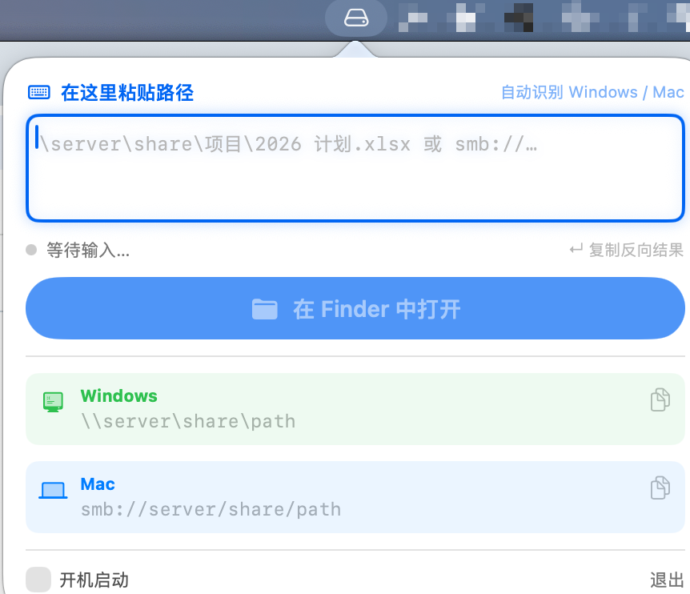
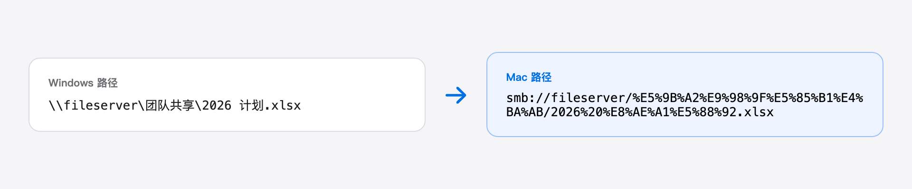

<div align="center">


# 共享转换器

**Windows 与 Mac 之间 SMB 共享路径一键互转的菜单栏小工具**

`\\server\share\路径` ⇄ `smb://server/share/路径`

[](#系统要求)
[](#系统要求)
[](LICENSE)
[](https://github.com/lanizz/smb-converter/releases)

</div>

<p align="center">
  
</p>

## 功能

- **常驻菜单栏**：点击顶部图标即用，不占 Dock
- **自动识别方向**：支持 `\\server\…`、`smb://…`、`file://…`、`//server/…`
- **自动编解码**：空格 → `%20`、中文 → UTF-8 百分号编码，反向自动还原
- **复制路径**：复制后自动转换并反向复制，回车即可粘贴
- **在 Finder 中打开**：一键挂载 SMB 共享，等同访达「连接服务器」
- **开机启动**：面板内一键开关（系统标准登录项）
- **完全本地**：不联网、不收集数据

<p align="center">
  
</p>

## 系统要求

- macOS 13（Ventura）或更高
- Apple 芯片（M 系列）与 Intel 均为原生通用二进制，无需 Rosetta

## 安装（推荐）

从 [**Releases**](https://github.com/lanizz/smb-converter/releases) 下载最新的 `ShareConverter-*.dmg`（镜像内应用名为「共享转换器」），打开后把 **共享转换器.app** 拖进 **Applications（应用程序）**。

DMG 内附《使用说明.html》，双击可查看完整图文指南。

### 首次打开

应用未经 Apple 公证（未使用付费开发者证书），首次启动可能被拦截，任选一种方式放行：

- **右键（或按住 Control 点按）应用 → 打开**，弹窗中点「打开」；或
- 「系统设置 → 隐私与安全性」底部点「**仍要打开**」；或
- 若提示「已损坏」，终端执行：
  ```bash
  xattr -dr com.apple.quarantine /Applications/共享转换器.app
  ```

## 使用

1. 在邮件 / 聊天 / 文档里复制一条共享路径；
2. 点菜单栏图标 —— 自动读取剪贴板、完成转换并复制好反向结果，面板保持打开；
3. 到目标窗口按 `⌘V` 粘贴；或点「**在 Finder 中打开**」直接挂载共享。

打开未保存凭据的共享时，系统会要求输入账号密码（由 macOS 认证与钥匙串处理，本工具不接触凭据）。

## 从源码构建

零第三方依赖，仅使用系统 SwiftUI / AppKit / ServiceManagement。

```bash
./build.sh
# 产物：
#   build/共享转换器.app
#   dist/共享转换器.dmg
```

- `SMBConverter.swift`：应用全部逻辑（单文件）
- `makeicon.swift`：用 Core Graphics 生成应用图标
- `assets/*-source.html`：README 截图的矢量源，可用无头浏览器重新渲染

## 卸载

点菜单栏图标 →「退出」，取消「开机启动」，再把 app 拖到废纸篓即可。

## License

[MIT](LICENSE)
